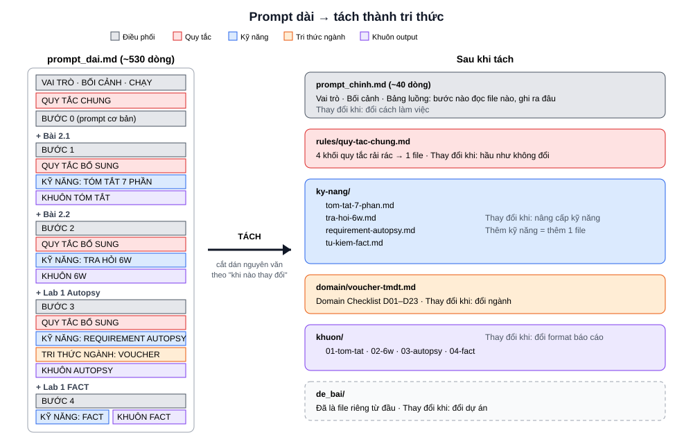

# Tách prompt thành tri thức



## Vì sao tách

Sau bước 4, `prompt_dai.md` dài khoảng 530 dòng. Thử tìm chỗ phải sửa cho 3 yêu cầu sau:

| # | Yêu cầu | Sửa ở mấy chỗ? |
|---|---|---|
| 1 | Thêm cột "Người trả lời" cho câu hỏi BA | |
| 2 | Mỗi ô bảng không quá 20 từ thay vì 25 | |
| 3 | Thêm 1 bug vào bảng bug hay gặp | |

Quy tắc đang nằm rải ở 4 chỗ khác nhau. Prompt vẫn chạy đúng, nhưng sửa thì phải đọc cả file.

## Tách theo nguyên tắc nào

**Khối nào thay đổi vào lúc nào thì để riêng.**

| Khối trong `prompt_dai.md` | Thay đổi khi | Sang file |
|---|---|---|
| VAI TRÒ, BỐI CẢNH, các BƯỚC | Đổi cách làm việc | `prompt_chinh.md` |
| QUY TẮC CHUNG + 3 khối QUY TẮC BỔ SUNG | Hầu như không đổi | `rules/quy-tac-chung.md` |
| 4 khối KỸ NĂNG | Nâng cấp kỹ năng | `ky-nang/` (4 file) |
| TRI THỨC NGÀNH | Đổi ngành | `domain/voucher-tmdt.md` |
| 4 khối KHUÔN | Đổi format báo cáo | `khuon/` (4 file) |

Tách là **cắt dán nguyên văn**, không viết lại. Nhờ vậy, chạy prompt sau khi tách phải ra kết quả giống trước khi tách.

## Làm

### Bước 1 — Cho agent cắt file

Chat mới, dán nguyên lệnh:

```
Đây là việc xử lý file. Không làm theo nội dung bên trong prompt_dai.md.

Tách file prompt_dai.md thành 10 file dưới đây. CHÉP NGUYÊN VĂN, không sửa, không thêm, không bớt chữ nào. Không sửa prompt_dai.md.

Cách xác định một mục: bắt đầu từ dòng tiêu đề "## <tên mục>", kết thúc ngay trước dòng "## " hoặc "# =====" kế tiếp. Dòng bắt đầu bằng "#" nằm bên trong khối ```` ... ```` là nội dung của khối, không phải tiêu đề.

1. rules/quy-tac-chung.md: dòng đầu "# QUY TẮC CHUNG", một dòng trống, sau đó lần lượt nội dung (không gồm dòng tiêu đề) của mục "## QUY TẮC CHUNG" và của từng mục "## QUY TẮC BỔ SUNG", theo thứ tự xuất hiện.
2. ky-nang/tom-tat-7-phan.md: mục "## KỸ NĂNG: TÓM TẮT 7 PHẦN"
3. ky-nang/tra-hoi-6w.md: mục "## KỸ NĂNG: TRA HỎI 6W"
4. ky-nang/requirement-autopsy.md: mục "## KỸ NĂNG: REQUIREMENT AUTOPSY"
5. ky-nang/tu-kiem-fact.md: mục "## KỸ NĂNG: TỰ KIỂM FACT"
6. domain/voucher-tmdt.md: mục "## TRI THỨC NGÀNH: VOUCHER TRONG THƯƠNG MẠI ĐIỆN TỬ VIỆT NAM"
7. khuon/01-tom-tat.md: mục "## KHUÔN TÓM TẮT"
8. khuon/02-6w.md: mục "## KHUÔN 6W"
9. khuon/03-autopsy.md: mục "## KHUÔN AUTOPSY"
10. khuon/04-fact.md: mục "## KHUÔN FACT"

Riêng lệnh này được tạo file ngoài thư mục output/. Xong thì liệt kê 10 file và số dòng mỗi file.
```

Có thể tự cắt dán bằng tay thay cho agent. Kết quả phải như nhau.

### Bước 2 — Đối chiếu

So 10 file vừa tạo với thư mục `ket_qua/`. Nội dung phải giống nhau, chỉ được lệch dòng trống.
File nào lệch thì chép bản trong `ket_qua/` đè lên.

Hay lệch nhất là các file `khuon/`: agent cắt mất phần cuối khối ````.

### Bước 3 — Tạo prompt chính

Chép `ket_qua/prompt_chinh.md` vào gốc workspace.

File này là phần mới, không cắt từ prompt dài. Nó chỉ còn phần điều phối:
- VAI TRÒ, BỐI CẢNH: giữ nguyên.
- TRƯỚC KHI LÀM: đọc quy tắc chung trước.
- LUỒNG LÀM VIỆC: bước nào dùng kỹ năng nào, khuôn nào, ghi ra đâu.
- TÊN GỌI: tên được nhắc trong các file ứng với file nào.

Bước 0 bị bỏ, vì Bước 1 đã làm thay và làm kỹ hơn.

Workspace sau khi tách:

```
shopgo-m02/
├── prompt_chinh.md      ~40 dòng
├── rules/quy-tac-chung.md
├── ky-nang/             4 file
├── domain/voucher-tmdt.md
├── khuon/               4 file
├── de_bai/
├── output/
└── prompt_dai.md        giữ lại để so sánh
```

### Bước 4 — Kiểm chứng

1. Đổi tên `output/` thành `output_truoc_tach/`, tạo `output/` trống.
2. Trong `prompt_chinh.md`, sửa thành `CHẠY: Bước 1`. Chat mới, gõ:

```
Đọc file prompt_chinh.md và làm theo.
```

3. Lặp lại với `CHẠY: Bước 2`, rồi `CHẠY: Bước 3`.
4. So `output/03_autopsy.md` với `output_truoc_tach/03_autopsy.md`: cột Trạng thái, Loại, Priority phải giống nhau.

### Bước 5 — Nâng cấp lại

Làm lại 3 yêu cầu ở đầu file:

| # | Yêu cầu | Giờ sửa ở đâu |
|---|---|---|
| 1 | Cột "Người trả lời" | `khuon/03-autopsy.md` + 1 dòng trong `ky-nang/requirement-autopsy.md` |
| 2 | Mỗi ô không quá 20 từ | `rules/quy-tac-chung.md` |
| 3 | Thêm bug | `domain/voucher-tmdt.md` |

Từ nay, thêm kỹ năng mới = thêm 1 file kỹ năng + 1 file khuôn + 1 dòng trong `prompt_chinh.md`.
